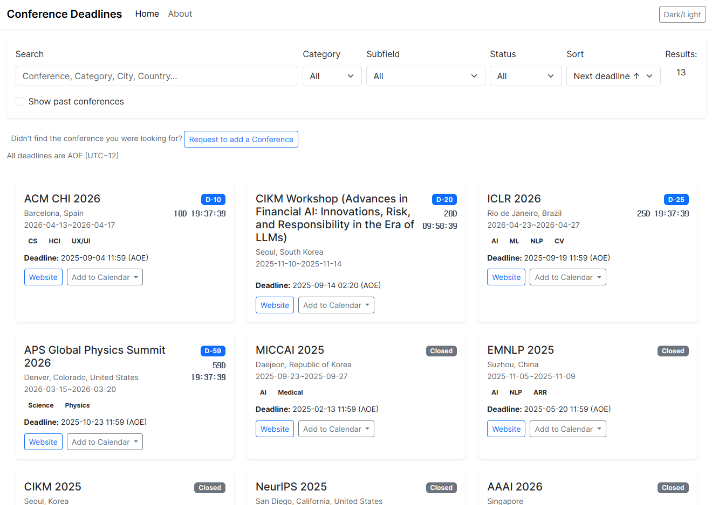

# Conference Deadlines

[](https://creativecommons.org/licenses/by-nc-sa/4.0/)
[](https://github.com/mindw96/Conference-Deadlines/actions/workflows/pages/pages-build-deployment)

An open-source website for tracking academic conference deadlines.

Live Site -> [alldeadlines.info](https://alldeadlines.info)

---



## Features

* **Real-time Countdown:** View upcoming deadlines with a live countdown timer.
* **Dynamic Filtering & Search:** Search and filter conferences by name, location, category, subfield, and status.
* **Add to Calendar:** Add conference schedules or submission deadlines to Google Calendar, Outlook, or an `.ics` file.
* **Suggest a Conference:** Submit a new conference or suggest edits through the public form.
* **Admin Review Flow:** Supabase Auth users listed in `public.admin_users` can review, approve, edit, or delete records.
* **Light/Dark Mode:** Switch between light and dark themes.
* **Explicit Sample Mode:** Local development can use a bundled data snapshot with ?demo=1. Live failures show a retry action instead of stale examples.

## Planned

* Email reminder subscriptions.
* Optional notification delivery via Supabase Edge Functions.

## Tech Stack

* **Frontend:** HTML5, CSS3, Vanilla JavaScript, Bootstrap 5
* **Backend & Database:** Supabase PostgreSQL, Row Level Security, Supabase Auth
* **Deployment:** GitHub Pages

## Project Layout

```text
index.html                  # Public app shell
admin.html                  # Admin dashboard shell
assets/js/utils.js          # Escaping, URL safety, AOE date helpers
assets/js/api.js            # Supabase client and API access
assets/js/data.js           # Data loading and normalization
assets/js/calendar.js       # Calendar links and ICS generation
assets/js/render.js         # Public card rendering and countdowns
assets/js/forms.js          # Suggestion and edit-suggestion forms
assets/js/app.js            # Public app orchestration
assets/js/admin.js          # Admin dashboard behavior
supabase_schema.sql         # Tables, validation, atomic RPCs, RLS, admin model
supabase_migration.sql      # Seed data
supabase_repair.sql         # Realigns an existing project with the schema file
scripts/smoke-test.mjs      # No-dependency smoke checks
scripts/serve.mjs           # Local static preview (127.0.0.1:4173)
tests/                     # PostgreSQL, JavaScript, and browser regression tests
```

## Deadline Time Convention

All submission deadlines are displayed as AOE (UTC-12).

Store deadline timestamps as UTC instants. For example, a deadline announced as `2025-09-19 23:59 AOE` should be stored as `2025-09-20T11:59:00Z`.

A conference with a start date but no end date is treated as a one-day event,
both in calendar exports and the past-conference filter. Deadline ICS exports
represent an instant and omit an equal start/end pair.

Editing other fields preserves unchanged deadline precision and category/subfield
names. The deadline inputs edit AOE minutes; changing a deadline resets its seconds
to zero. Public edit suggestions are blocked when existing deadlines cannot be
displayed, so a name-only edit cannot silently remove them.

## Local Development

This project has no build step.

```bash
npm ci
node scripts/serve.mjs
```

Then open:

```text
http://127.0.0.1:4173/
```

The default page reads the configured live database. To use the bundled snapshot without live reads or form submissions, open /?demo=1 on localhost. It includes historical examples and a dated AI conference snapshot; check the official conference site before relying on a deadline.

Run checks:

```bash
npm run check
npx playwright install chromium
npm run test:ui
```

Checks include syntax and fixture validation, PostgreSQL RLS/rollback tests using PGlite, deadline/calendar regressions, and Playwright desktop/mobile flows. Browser tests intercept all Supabase requests and never write to the live database. GitHub Actions runs both suites on every push and pull request.

## Supabase Setup

1. Create a Supabase project.
2. Run `supabase_schema.sql` in the Supabase SQL Editor.
3. Create an Auth user for the administrator.
4. Add that user to `public.admin_users`:

```sql
insert into public.admin_users (user_id, email)
select id, email
from auth.users
where email = 'you@example.com';
```

5. Run `supabase_migration.sql` to seed the sample conferences.
6. Update `assets/js/api.js` if you are using a different Supabase URL or anon key.

### Repairing an existing project

Run supabase_repair.sql in the SQL Editor **before publishing this frontend**.
It is byte-for-byte identical to the canonical schema and can be rerun. It adds
missing columns, installs validation and transactional RPCs, and replaces the
policies on the four application tables. It supports existing UUID deadline IDs
as well as the identity IDs used by fresh installations.

Existing conference records, suggestions, and administrator membership are
preserved. Repair never promotes Auth users. If a previous version enrolled users
automatically, review public.admin_users and explicitly remove only memberships
you have determined are unauthorized. A new project still requires the explicit
owner enrollment shown above.

New suggestions are checked for valid bounded JSON, timestamps, dates, names,
and HTTP(S) URLs. A validation trigger checks new and changed payloads, leaving malformed legacy
suggestions available to reject; the admin UI disables their approval. Changing
only a target reference during deletion does not revalidate an old payload.
New edit suggestions carry the complete areas map. Legacy single-category edit
suggestions merge that category into the target's existing areas.

save_conference and approve_suggestion use SECURITY INVOKER and the existing RLS
boundary. All conference changes, deadline replacement, and queue removal happen
in one transaction. A rejected or failed action retains the original data.
Deleted targets and already processed suggestions produce explicit errors.

The sample seed is optional and intended for a new demo project. Rerunning it
only adds missing sample conferences and their deadlines, without replacing
existing conferences or pending suggestions.

### Major AI conference snapshot

`data/ai-conferences.json` records 16 officially announced editions across
NeurIPS, ICLR, ICML, ACL, EMNLP, NAACL, EACL, CVPR, ICCV, ECCV, AAAI, IJCAI,
and KDD, checked on November 7, 2026. Every record includes official source
links; deadlines retain the source time and its UTC conversion. ARR submission
and conference commitment are separate stages. Unannounced dates stay empty.
ICCV 2027 dates are withheld because its official pages disagree; ECCV 2028's
host city comes from the official conference account announcement.

Update the snapshot, then regenerate its SQL:

```bash
node scripts/generate-conference-import.mjs
npm run check
```

Run `supabase_ai_conferences.sql` in the target project's SQL Editor to publish
the data. It adds missing conferences and deadline instants, reuses existing
conference IDs by name, and preserves all existing rows and administrator edits.
Ambiguous matches abort the transaction. Publishing GitHub Pages alone does not
update Supabase. `conferences.json` also contains these editions for local demos.

The snapshot covers main research tracks, not every workshop or special track.
For date-only/end-of-day AoE announcements, the stored minute is 23:59; this is a
display convention, not a claim about official seconds. ECCV 2026 instead uses
the published 23:00 CET deadlines (22:00 UTC). All dates are displayed in AoE.

## How to Contribute

Contributions are welcome.

* **Suggest a Change:** Use the public suggestion form, contact the maintainer on the [About page](https://alldeadlines.info/about.html), or open a GitHub issue.
* **Contribute Code:** Fork the repository, run `npm run check` and `npm run test:ui`, and submit a pull request.

## Security Notes

The browser uses a Supabase anon key, which is expected for public Supabase clients. Data safety depends on Row Level Security. Keep `supabase_schema.sql` and the deployed Supabase policies in sync; `supabase_repair.sql` realigns a project that has drifted.

Admin saves and approvals use atomic database functions; deletes verify that they affected a row. PostgREST answers a write that row-level security filtered out with a plain success and zero rows, so the admin page requests the affected rows back and treats an empty result as an error rather than reporting a delete that never happened.

User-provided values are escaped before being rendered into HTML. When adding new UI, use the helpers in `assets/js/utils.js`.

Browser dependencies use exact CDN versions and Subresource Integrity hashes.
Update the pinned URL and its SHA-384 hash together. Development dependencies
are pinned in package-lock.json.

Conference schedules export as all-day events with an exclusive next-day end;
submission deadlines retain their UTC instant. Search is debounced, cards are
reused, and the public grid loads 24 cards at a time. API reads use keyset
pagination rather than assuming the server's row limit.

References: [Supabase database functions](https://supabase.com/docs/guides/database/functions),
[Row Level Security](https://supabase.com/docs/guides/database/postgres/row-level-security),
[PGlite](https://pglite.dev/docs/), [iCalendar RFC 5545](https://www.rfc-editor.org/rfc/rfc5545).

## License

This project is licensed under the **Creative Commons Attribution-NonCommercial-ShareAlike 4.0 International License**. See the [LICENSE](LICENSE) file for details.
